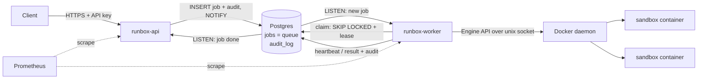

# runbox

A remote code execution service with defence-in-depth isolation, a
crash-safe job queue, and a tamper-evident audit log.

Clients submit source code over an HTTP API. Workers run each job in a fresh,
locked-down container under strict resource limits, then return stdout,
stderr, the exit code and a precise outcome (`succeeded`, `timed_out`,
`memory_limit_exceeded`, ...). Every state change is written to a hash-chained
audit log that detects after-the-fact edits, even edits made by a database
superuser.

```
$ curl -s -X POST localhost:8080/v1/jobs -H "Authorization: Bearer $KEY" \
    -d '{"language":"python","source":"print(sum(range(10**6)))"}'
{ "id": "3356243f-…", "status": "queued", ... }

$ curl -s "localhost:8080/v1/jobs/3356243f-…?wait=10s" -H "Authorization: Bearer $KEY"
{ "status": "succeeded", "result": { "exit_code": 0, "stdout": "499999500000\n", "duration_ms": 61 }, ... }
```

## Highlights

- **Isolation in layers.** Every job runs as an unprivileged user with no
  network, all capabilities dropped, `no_new_privs`, seccomp, a read-only root
  filesystem, and cgroup limits on memory (no swap), CPU, PIDs, file size and
  open files. An optional gVisor runtime adds a user-space kernel.
  [Threat model →](docs/THREAT_MODEL.md)
- **Proven against attacks.** CI runs 11 adversarial programs (fork bomb,
  memory bomb, output flood, network egress, filesystem writes, privilege and
  syscall escalation, ...) and asserts each one is contained.
- **Crash-safe queue.** Postgres `FOR UPDATE SKIP LOCKED` with leases,
  heartbeats and fencing. When a worker dies, its jobs are reaped and retried.
  A stale worker can't overwrite a newer result. Shutdown drains in-flight
  jobs gracefully.
- **Tamper-evident audit log.** SHA-256 hash chain, written in the same
  transaction as the state change it records, with append-only triggers as a
  first layer. `runbox-admin audit verify` pinpoints the first altered entry.
- **Fair and bounded.** Per-key concurrency caps, per-key token-bucket rate
  limits, and queue-depth backpressure (`429`/`503` with `Retry-After`).
- **Observable.** Prometheus metrics, a provisioned Grafana dashboard, and
  structured JSON logs with request IDs.
- **Small dependency footprint.** One direct third-party dependency (`pgx`). The
  Docker Engine API client and the Prometheus exposition format are
  implemented in this repo, so every isolation setting is visible in code
  rather than hidden in an SDK.

## Architecture



1. **Submit.** The API authenticates the key, applies rate limits and
   backpressure, and inserts the job and its audit entry in one transaction.
   The insert fires `NOTIFY` to wake an idle worker.
2. **Claim.** A worker atomically claims the oldest runnable job whose key is
   under its concurrency cap, and takes a lease on it.
3. **Run.** The worker stages the source on disk, then creates a container
   with the full isolation policy. It attaches to stdout/stderr *before*
   starting the container, and races four outcomes: natural exit, timeout,
   output overflow, or cancellation. It renews the lease every
   `LEASE_DURATION/3` while the job runs.
4. **Complete.** The result write is fenced on the lease, audited, and fires a
   `NOTIFY` that wakes any client long-polling for that job.

Design rationale and trade-offs: [docs/DESIGN.md](docs/DESIGN.md).

## Quick start

Requires Docker (with Compose) and Go 1.24+ for local builds.

```bash
make images                      # build sandbox images on your Docker host (once)
make up                          # Postgres, API, worker, Prometheus, Grafana
make key                         # prints an API key
export RUNBOX_API_KEY=rbx_...
make demo                        # run a sample job
```

- API: http://localhost:8080
- Grafana dashboard: http://localhost:3000 (anonymous admin, local only)
- Prometheus: http://localhost:9090

## API

All `/v1` endpoints except admin take `Authorization: Bearer rbx_...`.
Errors are always `{"error": {"code": "...", "message": "..."}}`.

| Method | Path | Description |
|---|---|---|
| `POST` | `/v1/jobs` | Submit a job → `202` with the job and a `Location` header |
| `GET`  | `/v1/jobs/{id}?wait=10s` | Get a job; `wait` long-polls (≤30s) until it's finished |
| `GET`  | `/v1/jobs?status=&limit=` | List your recent jobs |
| `POST` | `/v1/jobs/{id}/cancel` | Cancel a queued or running job |
| `GET`  | `/v1/languages` | Supported languages, default and max limits |
| `GET`  | `/healthz`, `/readyz`, `/metrics` | Liveness, readiness (DB ping), Prometheus |

Admin endpoints use `ADMIN_TOKEN`: `POST/GET /v1/admin/keys`,
`POST /v1/admin/keys/{id}/revoke`, `GET /v1/admin/audit?after=&job_id=`,
`GET /v1/admin/audit/verify`, `GET /v1/admin/jobs/{id}`.

**Submit body**

```json
{
  "language": "python",
  "source": "import sys; print(sys.stdin.read().upper())",
  "stdin": "hello",
  "limits": { "timeout_ms": 5000, "memory_mb": 128, "cpus": 0.5, "pids": 64, "output_bytes": 65536 }
}
```

Any limit you omit falls back to its default. Every limit is capped
(`GET /v1/languages` returns both the defaults and the caps).

**Statuses**: `queued` → `running` → one of `succeeded` (exit 0), `failed`
(non-zero exit), `timed_out`, `memory_limit_exceeded`,
`output_limit_exceeded`, `canceled`, `error` (an infrastructure failure after
all retries, not the program's fault).

Languages: Python 3.13, JavaScript (Node 22), C (gcc 14), C++ (g++ 14),
Bash. You can add more with a JSON file (`LANGUAGES_FILE`, see
[deploy/languages.example.json](deploy/languages.example.json)).

## Isolation summary

| Threat | Control |
|---|---|
| Fork bomb | `pids` cgroup limit (default 64) |
| Memory exhaustion | memory cgroup, swap disabled, OOM → `memory_limit_exceeded` |
| CPU hogging | CPU quota (`NanoCpus`) and a wall-clock timeout |
| Disk filling | read-only rootfs, 64 MiB `/tmp` tmpfs (counted against memory), `fsize` ulimit, no container logs on disk |
| Output flooding | byte-counted streaming; container killed the moment the cap is crossed |
| Network abuse / exfiltration | `NetworkMode: none` (loopback only) |
| Privilege escalation | uid 65534, `CapDrop: ALL`, `no-new-privileges`, Docker seccomp profile |
| Escape via kernel bugs | optional gVisor (`CONTAINER_RUNTIME=runsc`), plus the layers above to shrink the attack surface |
| Cross-tenant access | per-key scoping; other tenants' job IDs return `404` |

Each row is backed by a program in [`tests/adversarial/`](tests/adversarial).

## Benchmarks

Measured with `runbox-bench` on a **2-vCPU** cloud VM (Docker 29, runc,
8 worker slots), running a trivial Python job:

| Scenario | Throughput | End-to-end p50 / p99 | Queue wait p50 | Execution p50 |
|---|---|---|---|---|
| 1 client, sequential | — | 183 ms / 238 ms | 1 ms | 48 ms |
| 16 clients, 200 jobs | 10.4 jobs/s | 1.5 s / 1.9 s | 754 ms | 203 ms |

On this box the bottleneck is CPU spent creating and starting containers
(about 100 ms of runc work per job when uncontended). Throughput should grow
roughly with cores and with more workers. Profiling the single-client case
showed that long-poll re-check intervals were adding latency. Switching to
Postgres `LISTEN/NOTIFY` completion events cut p50 end-to-end latency from
356 ms to 183 ms (details in [DESIGN.md](docs/DESIGN.md#latency-work)).

Reproduce: `make up && make key && export RUNBOX_API_KEY=... && make bench`.

## Testing

```bash
make test                # unit tests: audit chain, rate limiter, stream demux, limits, metrics, ...
docker compose up -d postgres
make test-integration    # real API + worker + Postgres + Docker
```

The integration suite covers:

- the adversarial programs
- concurrency and per-key caps
- cancellation, both queued and running
- tenant isolation and key revocation
- validation, backpressure and rate limiting
- **crash recovery**: a "ghost" worker claims a job and dies; the job is
  reaped and rerun, and the ghost's late write is rejected
- **graceful shutdown**: a job interrupted by shutdown is released without
  using up a retry attempt
- **audit tampering**: rows edited after a superuser disables the triggers
  are detected at the exact sequence number

## Configuration

Everything is set through environment variables with sensible defaults; see
[`internal/config/config.go`](internal/config/config.go). The most important
ones:

| Variable | Default | Notes |
|---|---|---|
| `DATABASE_URL` | local Postgres | both services |
| `ADMIN_TOKEN` | *(empty: admin API off)* | API |
| `MAX_QUEUE_DEPTH` / `MAX_QUEUED_PER_KEY` | 10000 / 500 | API backpressure |
| `RATE_LIMIT_RPS` / `RATE_LIMIT_BURST` | 20 / 40 | per key, overridable per key |
| `MAX_ATTEMPTS` | 3 | retries for infrastructure failures and lost workers |
| `WORKER_CONCURRENCY` | 4 | job slots per worker |
| `LEASE_DURATION` | 30s | heartbeat every lease/3 |
| `SHUTDOWN_GRACE` | 30s | time for in-flight jobs on SIGTERM |
| `CONTAINER_RUNTIME` | runc | `runsc` for gVisor |
| `SECCOMP_PROFILE` | Docker default | path to a stricter custom profile |
| `JOBS_DIR` / `HOST_JOBS_DIR` | `/var/lib/runbox/jobs` | where job files are staged, as seen by the worker and by the Docker daemon |

## Project layout

```
cmd/
  runbox-api/       HTTP API server
  runbox-worker/    job executor
  runbox-admin/     migrations, key management, audit verification
  runbox-bench/     load generator
internal/
  api/              handlers, auth/rate-limit middleware, NOTIFY-driven long-polling
  audit/            hash chain: append, verify, list
  sandbox/          Docker Engine API client, isolation policy, stream demux
  store/            Postgres data layer and queue (claim / heartbeat / reap / fence)
  worker/           slot loops, heartbeats, cancellation, graceful shutdown
  metrics/          Prometheus text-format registry
  ratelimit/        token buckets
  db/migrations/    schema, including append-only triggers
  integration/      end-to-end tests
tests/adversarial/  hostile programs with expected outcomes
sandbox-images/     Dockerfiles for language images
deploy/             Prometheus, Grafana, example config
docs/               design and threat model
```

## Known limitations and future work

- **Container start latency.** A pool of pre-created, paused containers (or
  Firecracker snapshots) would cut the roughly 100 ms start time.
- **Rate limits are per API replica.** A shared limiter (Redis, or a
  Postgres-backed one) would make limits global.
- **The per-key concurrency cap is soft.** Two workers claiming at the same
  instant can overshoot it by one. An advisory lock per key would make it
  strict.
- **Audit chain anchoring.** Periodically publishing the head hash somewhere
  external (object storage with object lock, or a transparency log) would
  also detect a rewrite of the entire chain.
- **Multi-file projects and dependencies**: would need a package cache
  mounted read-only into the container.
